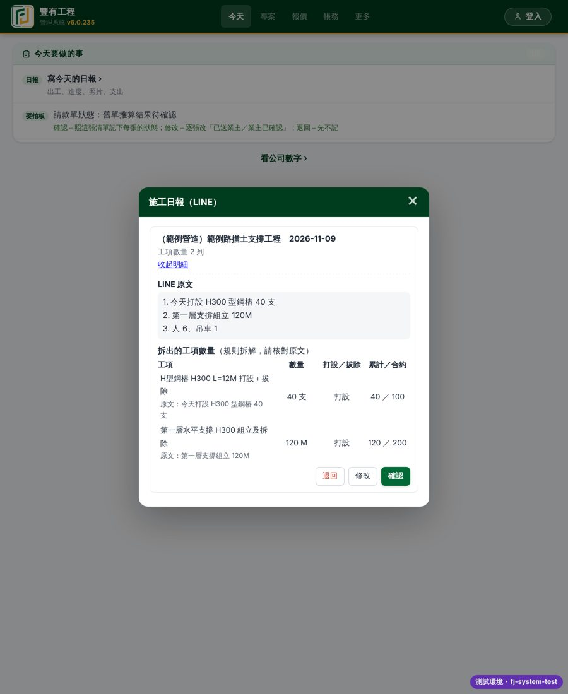
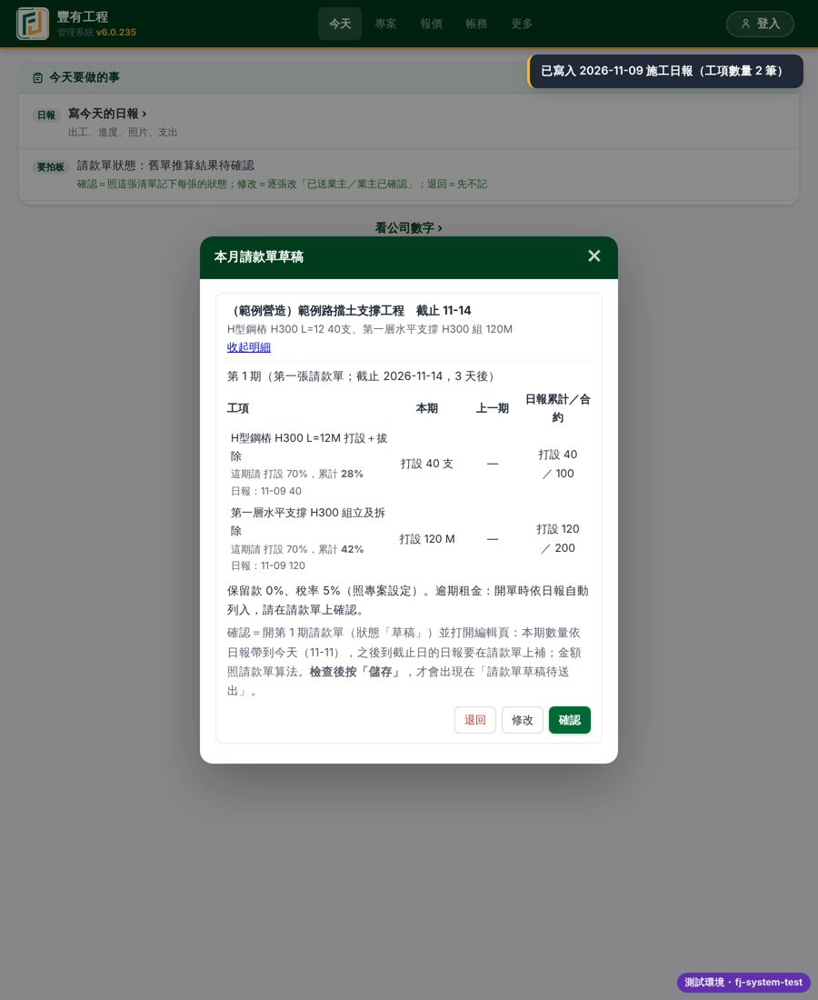
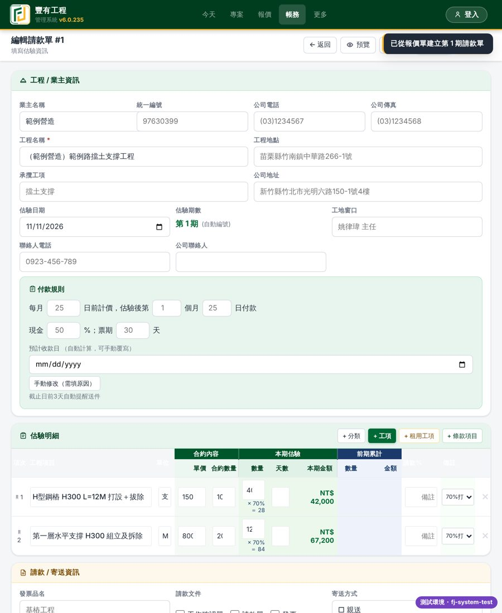
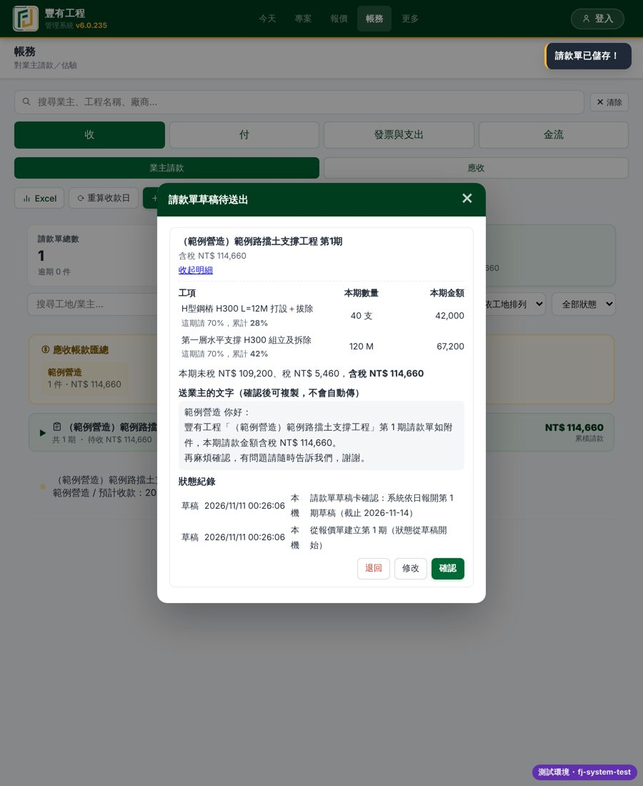
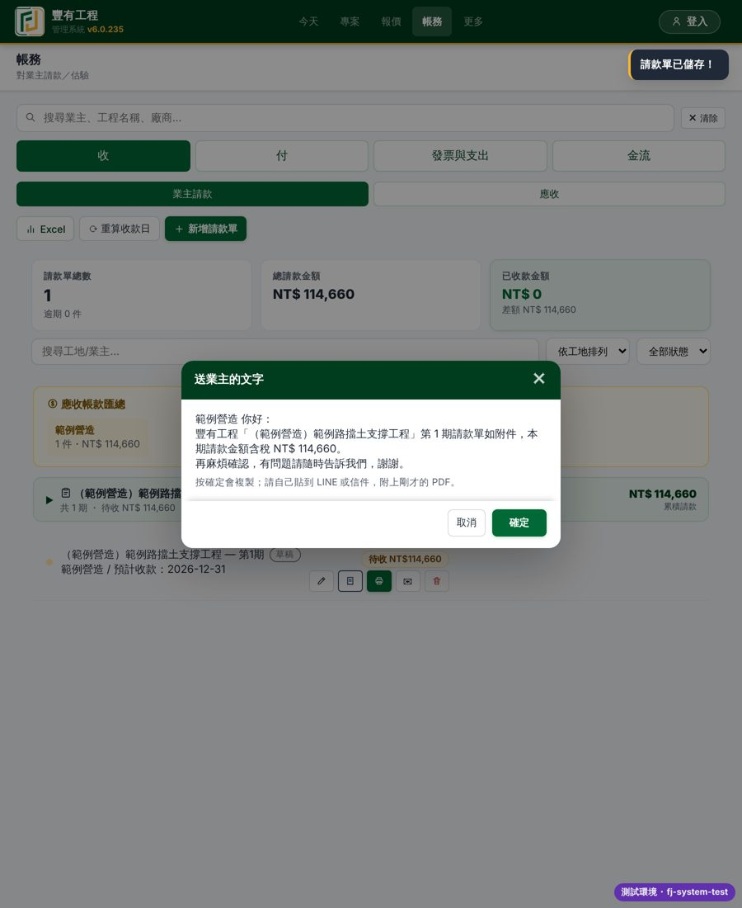
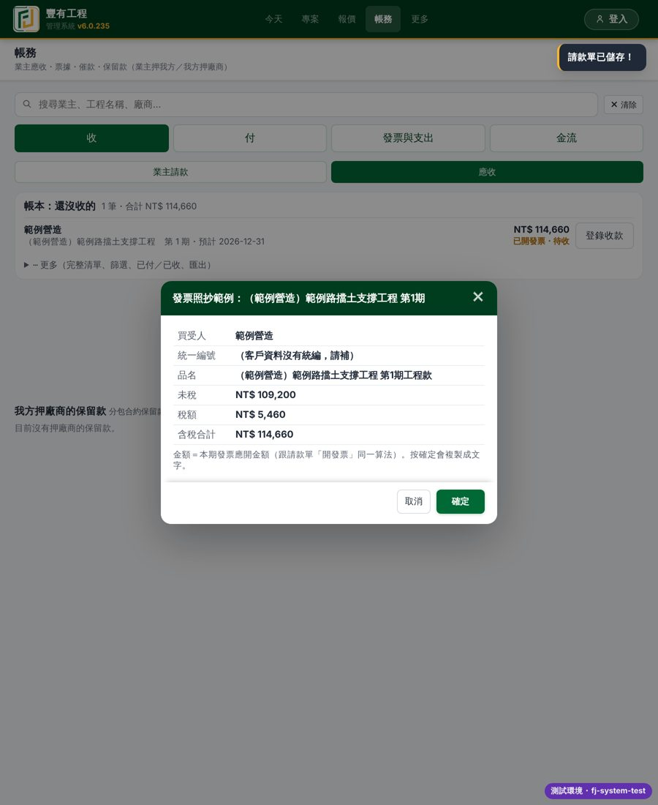
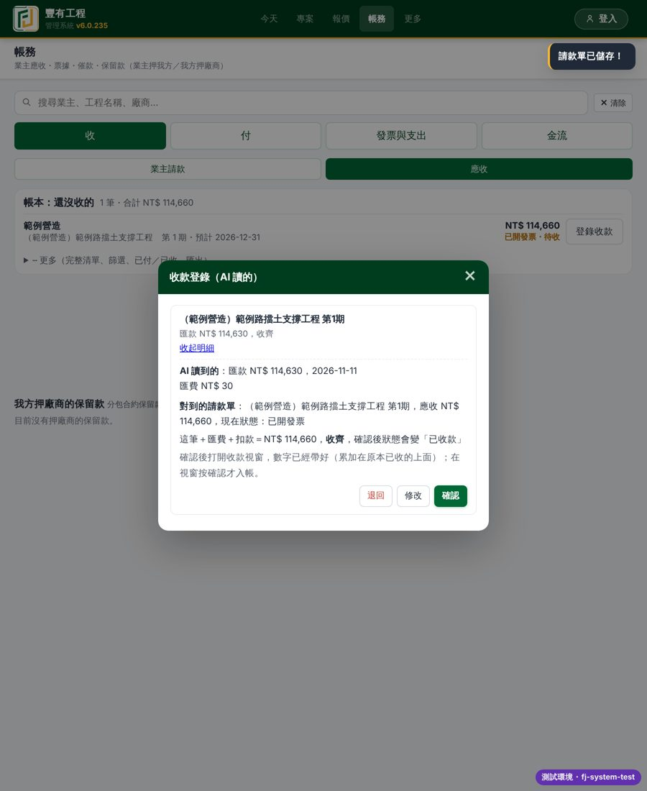
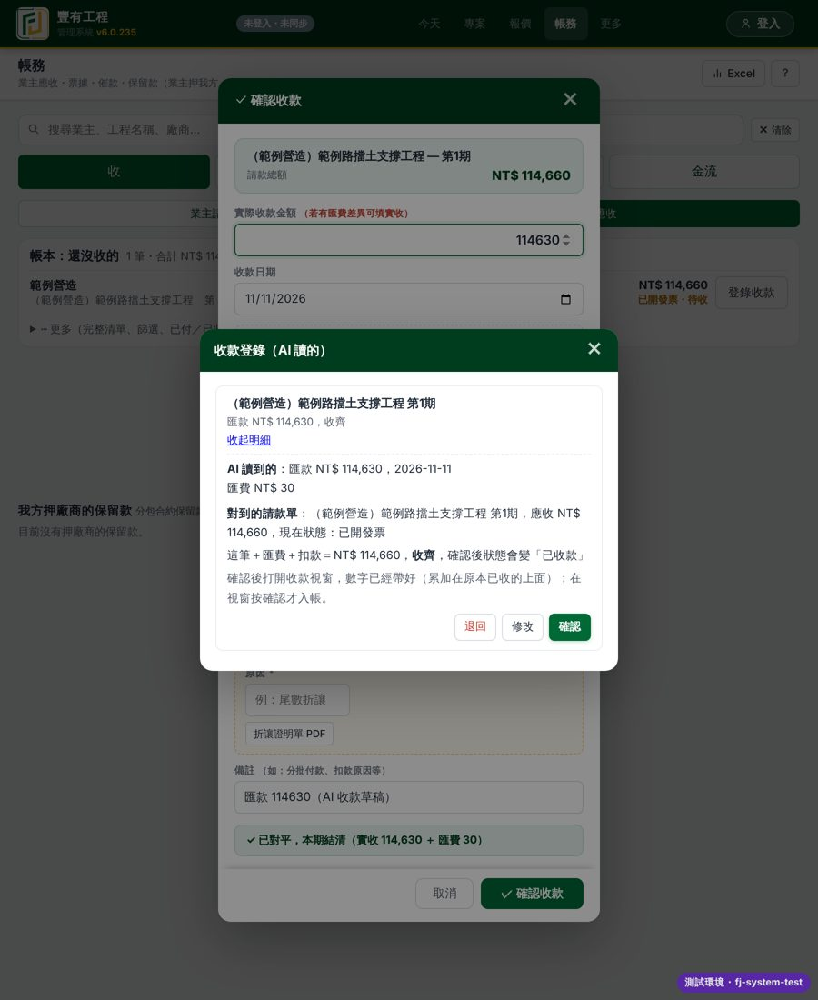
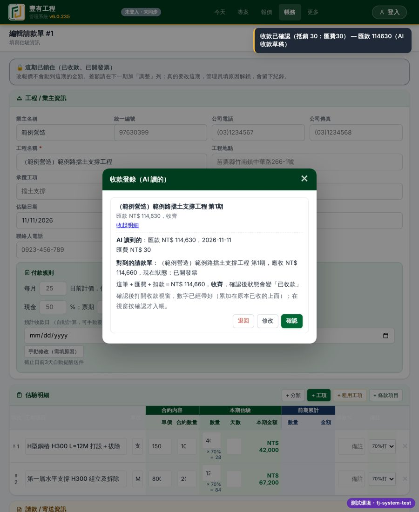

# 請款整條演練（合成資料）

v6.0.236（暫定）健檢修正之後，用合成的案子把請款整條跑一次：日報 → 請款單草稿 → 送業主 → 業主確認 → 發票 → 收款。
用本機資料模式跑，不連雲端，也不碰正式資料。重跑：`CHROMIUM_PATH=… node tools/billing-drill.js <網站資料夾> docs/請款鏈演練`

```
LINE 日報卡 ─確認→ 日報寫進數量
      ↓
本月請款單草稿卡 ─確認→ 開第 1 期（草稿）→ 編輯頁按「儲存」
      ↓
請款單草稿待送出卡（金額照存檔算）─確認→ 已送業主＋PDF＋送業主文字
      ↓
業主回覆卡 ─確認→ 業主已確認
      ↓
登錄發票 → 自動「已開發票」
      ↓
收款登錄卡 ─確認→ 收款視窗帶好數字 → 按確認才入帳 → 已收款
```

合成案子：「（範例營造）範例路擋土支撐工程」，H300 型鋼樁 100 支（打設＋拔除，每支 1,500）、第一層支撐 200M（組立及拆除，每 M 800），合約沒寫裝設 %＝報價條件預設（拆除 30%）→ 打設那期 70%。

| 步驟 | 截圖 | 看什麼 |
| :-- | :-- | :-- |
| 1 |  | 日報「支撐組立 120M」記成打設（健檢 H2：原本「組立及拆除」被判成只有拆除） |
| 2 |  | 每個工項寫「這期請 打設 70%，累計 28%／42%」（健檢 H5） |
| 3 |  | 第 1 期草稿，數量依日報帶入，請款 % 70 |
| 4 |  | 含稅 NT$ 114,660＝(40×1,500×70%＋120×800×70%)×1.05（健檢 H1：原本永遠 0、按確認被擋）；送業主文字沒有「您」 |
| 5 |  | 業主回覆 → 確認才記「業主已確認」 |
| 6 |  | 登錄發票後狀態自動變「已開發票」 |
| 7 |  | 匯款 114,630＋匯費 30＝應收 |
| 8 |  | 收款視窗帶好數字，Lotion 按確認才入帳 |
| 9 |  | 狀態「已收款」；狀態紀錄記了建立（草稿）→ 草稿卡確認 → 送出 → 業主確認 4 筆（已開發票、已收款看發票紀錄與收齊，Lotion 確認「舊單推算」卡之後才會自動記進紀錄） |

跑完的結果（腳本輸出）：狀態 paid；第 1 項請款 70%、累計 28%；畫面沒有任何 JS 錯誤。

這次演練沒有涵蓋、要靠冒煙測試的：下一期從草稿開始（H3）、空白單／累計超過 100% 的舊單檢查卡（H4／H5）、只有逾期租金也出草稿卡（M1）、打設拔除兩列停租（M4）。
